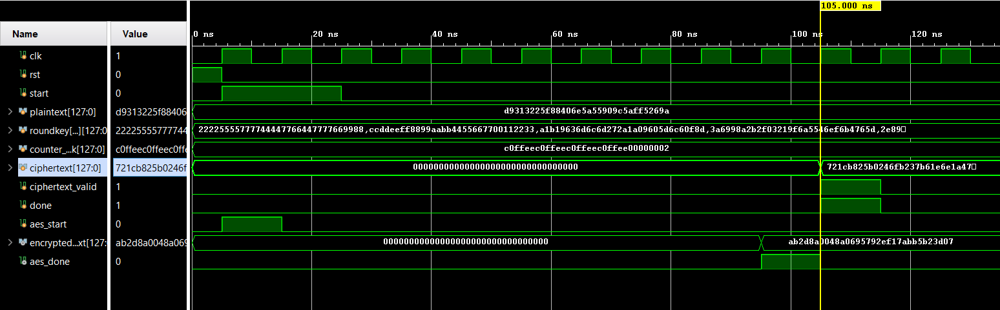
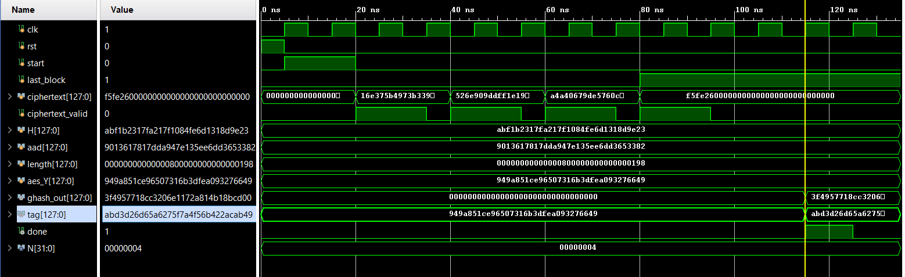

# AESGCM
# AES-256-GCM RTL Design and Optimization

A modular RTL implementation of the **Advanced Encryption Standard with 256-bit keys in Galois/Counter Mode (AES-256-GCM)**, developed using Verilog/SystemVerilog and verified through simulation in Xilinx Vivado.

The project focuses on authenticated encryption, modular hardware design, and architectural optimizations to reduce execution latency while maintaining functional correctness.

## Overview

AES-GCM combines encryption and authentication to provide:

- **Confidentiality:** AES Counter (CTR) mode encrypts plaintext.
- **Integrity:** GHASH processes Additional Authenticated Data (AAD) and ciphertext.
- **Authentication:** An authentication tag is generated to support verification of data integrity and authenticity.

## Architecture

The design consists of four major functional modules integrated by a top-level AES-GCM controller.

| Module | Function |
|---|---|
| AES-256 Key Expansion | Generates the 15 round keys required for AES-256 encryption. |
| AES-256 Encryption Core | Performs AES transformations, including SubBytes, ShiftRows, MixColumns and AddRoundKey. |
| AES-CTR | Generates ciphertext using AES encryption of counter blocks. |
| GHASH | Computes the authentication hash using multiplication in \(GF(2^{128})\). |
| AES-GCM Controller | Coordinates the submodules, counter management, data flow and authentication-tag generation. |

## Key Optimizations

### 1. Parallel Round-Key Generation
- Redesigned key expansion to generate two round keys within one iteration.
- Reduced key expansion latency from 14 to 6 clock cycles.

### 2. Round-Key Storage and Sharing
- Generated round keys are stored in internal registers at the top level.
- Shared the precomputed round keys between the AES-256 encryption core and AES-CTR module.
- Avoided repeated key expansion, reducing redundant computation and switching activity.

### 3. Two AES Rounds per Clock Cycle
- Modified the AES datapath to execute two rounds within a single clock cycle.
- Reduced AES-256 encryption latency from 15 to 8 clock cycles.

### 4. Partial-Block Handling
- Implemented byte-validity masking for the final partial ciphertext block.
- Ensured that valid ciphertext bytes are processed appropriately by the GHASH authentication engine.

## Simulation Results

The individual modules and the integrated AES-GCM design were functionally verified using Xilinx Vivado simulation.

### AES-256 Encryption
<!-- Add the AES-256 simulation waveform below -->

### AES-CTR
<!-- Add the AES-CTR simulation waveform below -->

### GHASH Authentication
<!-- Add the GHASH simulation waveform below -->

### AES-GCM: Original vs. Optimized Design
<!-- Add the top-level simulation waveforms below -->

*The waveform images above are placeholders for the corresponding simulation screenshots. Replace them with your actual screenshots using the same filenames, or update the paths to match your repository.*

## Performance Comparison

| Parameter | Original Design | Optimized Design |
|---|---:|---:|
| Key Expansion Latency | 14 cycles | 6 cycles |
| AES-256 Encryption Latency | 15 cycles | 8 cycles |
| AES-CTR Latency | 17 cycles | 10 cycles |
| Overall AES-GCM Latency | 126 cycles | 72 cycles |

**Overall latency reduction: approximately 42.9%.**

The optimizations reduce the number of clock cycles required for encryption and authentication while preserving the expected ciphertext and authentication tag for the test inputs used during verification.

## Verification

The design was tested using predefined inputs consisting of:

- 256-bit secret key
- 96-bit initialization vector (IV)
- Plaintext data spanning multiple blocks
- Additional Authenticated Data (AAD)

The generated ciphertext and authentication tag were compared against the expected test-vector outputs.

## Tools and Technologies

- **HDL:** Verilog/SystemVerilog
- **FPGA Design and Simulation:** Xilinx Vivado
- **Design Concepts:** RTL Design, AES-256, AES-CTR, GHASH, FSM Design, Datapath Optimization
- **Verification:** Testbench Development, Functional Simulation, Waveform Analysis
- **Optimization:** Latency Reduction, Parallel Round-Key Generation, Shared Round-Key Storage

## Applications

AES-GCM is used in security-sensitive systems, including:

- Transport Layer Security (TLS)
- Virtual Private Networks (VPNs)
- Secure communication systems
- Internet of Things (IoT)
- Cloud and network security

## References

1. NIST, [FIPS 197 — Advanced Encryption Standard (AES)](https://csrc.nist.gov/pubs/fips/197/final).
2. NIST, [SP 800-38D — Recommendation for Block Cipher Modes of Operation: Galois/Counter Mode (GCM) and GMAC](https://csrc.nist.gov/pubs/sp/800/38/d/final).
3. NIST, [Cryptographic Algorithm Validation Program](https://csrc.nist.gov/projects/cryptographic-algorithm-validation-program).

---

**Project Focus:** RTL Design | Cryptographic Hardware | FPGA Simulation | Performance Optimization
